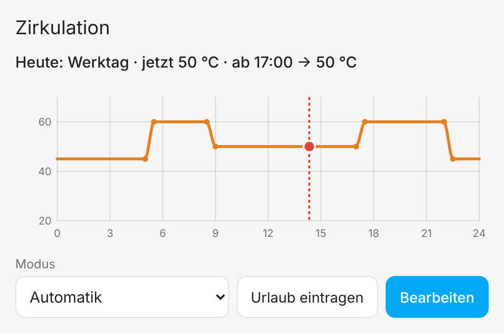
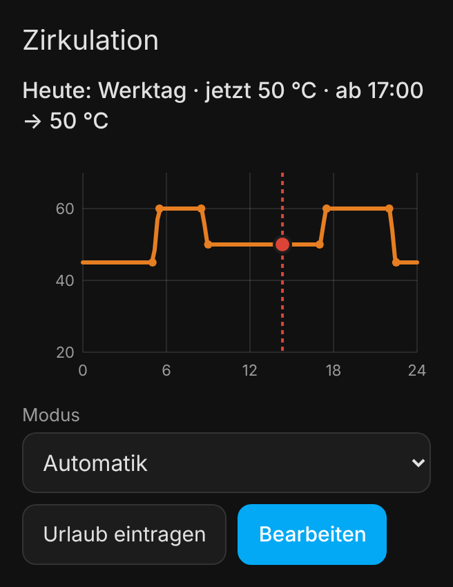
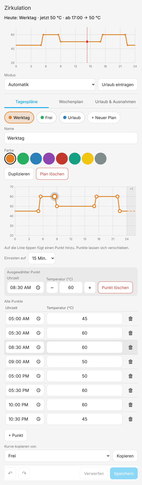
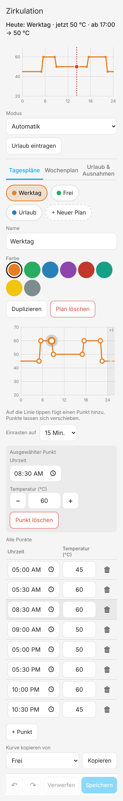
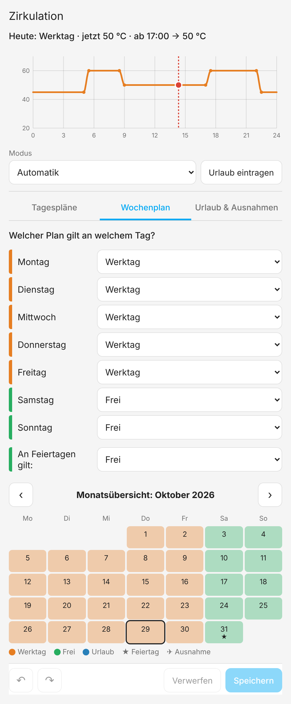
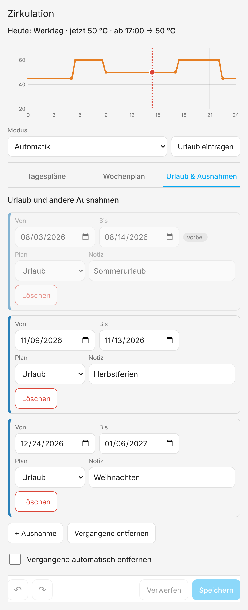

# Curve Scheduler – Tagesverläufe für Sollwerte in Home Assistant

🇬🇧 [English version](README.md)

**Curve Scheduler** berechnet einen Wert, der sich über den Tag verändert, und
schreibt ihn regelmäßig in ein Gerät. Typisch ist die Soll-Temperatur einer
Warmwasser-Zirkulation, es funktioniert aber mit jedem Zahlenwert:
Pufferspeicher, Raumtemperatur, Pumpendrehzahl, Helligkeit …

Der Verlauf wird durch wenige **Punkte** (Uhrzeit → Wert) festgelegt. Die
Werte dazwischen werden berechnet, weich und ohne Sprung um Mitternacht. Für
jeden Tag gilt ein **Tagesplan** (z. B. *Werktag*, *Frei*, *Urlaub*). Welcher
das ist, bestimmen der Wochenplan, ein Feiertagskalender oder Ausnahmen für
einen Zeitraum.

**Alle im Haushalt können die Pläne direkt in einer Dashboard-Karte
bearbeiten**, am Handy oder am PC, ohne YAML, Automationen,
Entwicklerwerkzeuge oder Admin-Rechte.

  
  

## Funktionen

- Kurven-Editor: Punkte mit Maus oder Finger ziehen oder Werte in Felder tippen
- Vier Übergänge: Stufe, linear, weich und Kurve (monoton kubisch, ohne Überschwingen)
- Wochenplan, Feiertagsplan (Workday-Sensor oder beliebiger Kalender), Ausnahmen wie Urlaub
- Manueller Modus („bis morgen den Plan *Frei* verwenden“) über die Karte, eine Auswahl-Entity oder eine Aktion
- Rückgängig/Wiederholen, *Speichern*/*Verwerfen* und Warnung bei ungespeicherten Änderungen
- Mehrere Karten gleichzeitig offen: Änderungen erscheinen überall, gleichzeitiges Speichern wird erkannt
- Schreibt in `number`-, `input_number`-, `climate`- oder `water_heater`-Entities
- Deutsch und Englisch, helles und dunkles Design, ab 320 px Breite

## Installation

### HACS (empfohlen)

1. **HACS** öffnen → Menü (⋮) → **Benutzerdefinierte Repositories**.
2. `https://github.com/timzifer/ha-curve-scheduler` mit dem Typ **Integration** hinzufügen.
3. Nach **Curve Scheduler** suchen, installieren und Home Assistant neu starten.

### Manuell

Den Ordner `custom_components/curve_scheduler` in den Ordner `custom_components`
der Home-Assistant-Konfiguration kopieren und neu starten.

Die Dashboard-Karte gehört zur Integration und wird automatisch registriert.
Eine Dashboard-Ressource muss **nicht** angelegt werden.

## Einrichtung (einmalig durch einen Administrator)

**Einstellungen → Geräte & Dienste → Integration hinzufügen → Curve Scheduler**

| Einstellung | Bedeutung | Standard |
|---|---|---|
| Name | z. B. „Zirkulation“ | – |
| Ziel | `number`, `input_number`, `climate` (Attribut `temperature`) oder `water_heater` | – |
| Schreibintervall | Minuten zwischen zwei Schreibvorgängen (1–60) | 5 |
| Übergang zwischen Punkten | Stufe / linear / weich / Kurve | Kurve |
| Minimum / Maximum | erlaubter Bereich, gleichzeitig die Achse im Diagramm | vom Ziel, sonst 20 / 70 |
| Schrittweite | Rundung vor dem Schreiben | 0,5 |
| Einheit | Anzeige in der Karte | vom Ziel |
| Feiertagsquelle | optional: Workday-Binärsensor **oder** ein Kalender (jedes Ereignis = freier Tag) | – |
| Schreib-Schwelle | nur schreiben, wenn sich der Wert um mindestens diesen Betrag ändert | 0 |

Alle Einstellungen lassen sich später unter **Konfigurieren** ändern. Es sind
beliebig viele Instanzen möglich (z. B. Zirkulation und Pufferspeicher). Beim
Einrichten entstehen zwei Beispielpläne: *Werktag* und *Frei*.

> **Workday-Sensor:** Die Workday-Integration meldet auch Wochenenden als
> „kein Arbeitstag“. Sollen Samstag und Sonntag ihre eigenen Pläne aus dem
> Wochenplan verwenden, den Workday-Sensor mit allen sieben Tagen als
> Arbeitstage einrichten. Dann meldet er nur gesetzliche Feiertage.

### Karte hinzufügen

Dashboard bearbeiten → **Karte hinzufügen** → **Curve Scheduler**. In den Karteneinstellungen:

- welche Instanz angezeigt wird,
- **Kompakt** (Heute, Editor bei Bedarf) oder **Voll** (Editor immer offen),
- ob Benutzer ohne Admin-Rechte bearbeiten dürfen (Standard: ja).

## Bedienung

### Heute

Das Diagramm zeigt den heutigen Verlauf, die rote Linie die aktuelle Uhrzeit.
Darüber steht eine Zusammenfassung, z. B.
*Heute: Werktag · jetzt 58 °C · ab 22:00 → 45 °C*.

- **Modus:** *Automatik* folgt dem Wochenplan. Wird ein Plan gewählt, gilt er, bis wieder *Automatik* gewählt wird.
- **Urlaub eintragen:** Zeitraum und den Plan für diese Zeit angeben.
- **Bearbeiten** öffnet den Editor.

 

### Tagespläne

  
  

- Oben den Plan wählen. **+ Neuer Plan**, umbenennen, Farbe wählen, **Duplizieren** oder **Plan löschen**.
  Ein Plan, der noch an einem Wochentag, an Feiertagen oder in einer Ausnahme verwendet wird, lässt sich nicht löschen. Die Karte sagt, wo er verwendet wird.
- **Punkt ziehen** ändert Uhrzeit und Wert. Punkte rasten auf 15 Minuten (einstellbar) und die Schrittweite ein und lassen sich nicht über ihre Nachbarn hinausziehen. Beim Ziehen werden Uhrzeit und Wert angezeigt.
- **Auf die Linie tippen** fügt dort einen Punkt hinzu.
- **Auf einen Punkt tippen** wählt ihn aus. Unter dem Diagramm lassen sich Uhrzeit und Wert eintippen, mit − / + ändern oder der Punkt löschen.
- Die **Tabelle aller Punkte** bietet dasselbe ohne Ziehen: Uhrzeit und Wert ändern, Punkte löschen, **+ Punkt**.
- Das gestrichelte Ende zeigt, wie die Kurve in den nächsten Tag übergeht.
- **Kurve kopieren von** übernimmt alle Punkte eines anderen Plans.

### Wochenplan

Für jeden Wochentag und für Feiertage einen Plan wählen. Die Monatsübersicht
zeigt, welcher Plan an welchem Tag gilt, inklusive Feiertagen (★) und
Ausnahmen (✈).

### Urlaub & Ausnahmen

Jede Ausnahme hat einen Zeitraum, einen Plan und eine Notiz. Vergangene
Einträge werden ausgegraut und lassen sich mit einem Tipp oder automatisch
entfernen.

### Speichern

Änderungen gelten erst nach **Speichern**. **Rückgängig** und
**Wiederholen** gehen durch die Änderungen, **Verwerfen** verwirft alle. Hat
inzwischen jemand anderes gespeichert, erscheint *„Wurde inzwischen geändert –
neu laden?“*.

Nach dem Speichern wird der neue Wert sofort geschrieben.

## So wird der Wert berechnet

- Ein Plan beschreibt einen Tag von 00:00 bis 24:00. **Über Mitternacht**
  läuft die Kurve zum ersten Punkt des Plans des **Folgetags**. Der Wechsel
  von Werktag zu Wochenende erzeugt also keinen Sprung (außer bei *Stufe*).
- Priorität für einen Tag: **manueller Modus > Ausnahme > Feiertag > Wochentag**.
- *Kurve* ist eine monotone kubische Interpolation (PCHIP, Fritsch–Carlson).
  Sie geht durch alle Punkte, schwingt nicht über und hat keine Knicke.
  *Weich* verwendet Smoothstep zwischen zwei Punkten.
- Gerechnet wird mit der lokalen Uhrzeit. An Tagen der Zeitumstellung wird die
  Stunde 02:00–03:00 übersprungen bzw. doppelt durchlaufen, ohne Fehler.
- Vor dem Schreiben wird auf Min/Max begrenzt und auf die Schrittweite gerundet.

Die Berechnung existiert zweimal: in Python (Backend) und TypeScript
(Vorschau in der Karte). Beide werden gegen dieselbe Datei mit Testvektoren
geprüft (`tests/vectors/interpolation.json`, Toleranz 1e‑6). Vorschau und
geschriebener Wert stimmen deshalb überein.

## Wann wird geschrieben?

- im eingestellten *Schreibintervall* (auf volle Minuten ausgerichtet),
- sofort bei: Start von Home Assistant (sobald das Ziel verfügbar ist), *Speichern*,
  Wechsel des Modus, Änderung der Feiertagsquelle, Einschalten und *Jetzt anwenden*,
- nur, wenn sich der Wert vom aktuellen Wert des Ziels unterscheidet; beim regelmäßigen Schreiben gilt zusätzlich die *Schreib-Schwelle*,
- nie, solange die Instanz ausgeschaltet ist (der Sensor zeigt den berechneten Wert trotzdem),
- nicht, solange das Ziel `unavailable`/`unknown` ist: Es wird einmal gewarnt, und sobald das Ziel wieder da ist, wird sofort geschrieben.

## Entities

Pro Instanz entsteht ein Gerät **Curve Scheduler &lt;Name&gt;** mit:

| Entity | Zweck |
|---|---|
| `sensor.<name>_setpoint` | aktueller Sollwert; Attribute `profile`, `reason` (weekday/holiday/exception/override), `next_point_time`, `next_point_value`, `value_in_1h` |
| `sensor.<name>_profile` | Name des aktiven Plans |
| `switch.<name>_active` | Instanz ein/aus |
| `select.<name>_mode` | `auto` (Automatik) oder ein Plan (manueller Modus) |
| `button.<name>_apply_now` | sofort schreiben |

Modus, Schalter und alle Pläne bleiben über Neustarts erhalten.

## Aktionen

| Aktion | Felder |
|---|---|
| `curve_scheduler.set_override` | `config_entry_id`, `profile` (Name oder ID), optional `until` |
| `curve_scheduler.clear_override` | `config_entry_id` |
| `curve_scheduler.add_exception` | `config_entry_id`, `from`, optional `to`, `profile`, optional `note` – liefert `exception_id` |
| `curve_scheduler.remove_exception` | `config_entry_id`, `exception_id` **oder** `date` |
| `curve_scheduler.apply_now` | `config_entry_id` |

So lässt sich z. B. bei längerer Abwesenheit automatisch der Urlaubsplan
aktivieren (Automation mit der Aktion `curve_scheduler.set_override`).

## Entwicklung

Siehe [README.md](README.md#development) und [docs/ACCEPTANCE.md](docs/ACCEPTANCE.md).

## Releases

HACS installiert `curve_scheduler.zip` aus dem neuesten GitHub-Release. Es muss
also mindestens ein Release geben. Der Workflow *Release* baut die Karte,
setzt die Version in `manifest.json` und hängt die Zip-Datei an. Starten:

- Tag pushen: `git tag v0.1.0 && git push origin v0.1.0`
- **Actions → Release → Run workflow** und den Tag eingeben, z. B. `v0.1.0`
- auf GitHub ein Release mit neuem Tag veröffentlichen

Bei einem gepushten Tag oder manuellem Start legt der Workflow das Release selbst an.

## Lizenz

MIT
