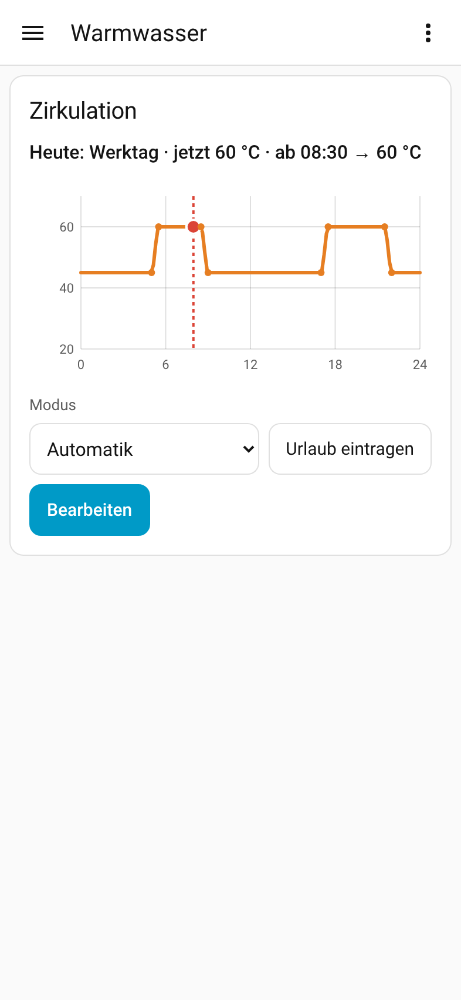
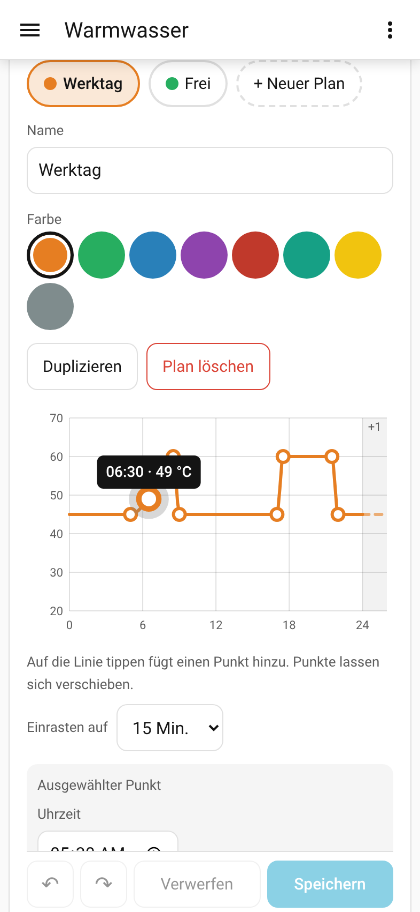
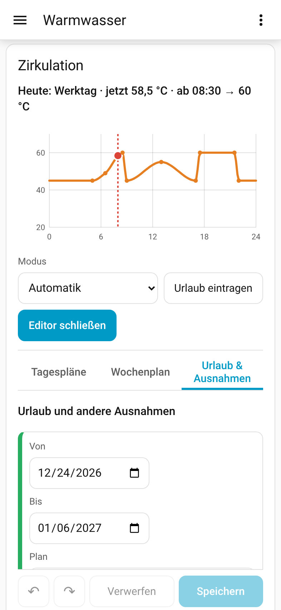

# Acceptance test

Run on 2026-10-26 against a fresh **Home Assistant 2026.2.3** (Python 3.13,
`home-assistant-frontend 20260128.6`) with the integration from this
repository. The scripts in [`scripts/acceptance`](../scripts/acceptance)
reproduce the run:

```bash
hass -c <config dir with scripts/acceptance/configuration.yaml and a custom_components link>
python scripts/acceptance/setup_instance.py <workdir>/e2e.json     # onboarding, users, config flow, dashboard
node   scripts/acceptance/mobile_non_admin.cjs <workdir>            # Playwright, phone viewport, non-admin
python scripts/acceptance/restart_check.py <workdir>/e2e.json scripts/acceptance before
# restart Home Assistant
python scripts/acceptance/restart_check.py <workdir>/e2e.json scripts/acceptance after
```

| # | Criterion | Result | How it was checked |
|---|---|---|---|
| 1 | Installation and setup completely in the UI, no YAML | ✅ | Config flow driven through the same REST endpoints the UI uses (`/api/config/config_entries/flow`). Min/max were taken from the target (20/70). Entities `sensor.zirkulation_sollwert`, `sensor.zirkulation_profil`, `switch.zirkulation_aktiv`, `select.zirkulation_modus`, `button.zirkulation_jetzt_anwenden` appeared; the card loaded **without** a dashboard resource (served by the integration through `add_extra_js_url`). HACS installation itself is covered by the HACS action in CI. |
| 2 | Non-admin on a phone: move a point, add a point by fields, change Saturday, add a holiday; value written at once | ✅ | User "Oma" (group *users*, no admin) in a 393×851 touch viewport. A point was moved with real touch events (CDP `Input.dispatchTouchEvent`). A point was added with **+ Punkt** and its value typed (55). Saturday was set to *Werktag* and a holiday 24.12.–06.01. was entered, then **Speichern**. The target `input_number` changed **immediately** from 60.0 to 58.5 (the moved point lies in today's curve). No browser console errors. |
| 3 | Preview and written value match (≤ step/2) | ✅ | `zeitprofil/preview` (backend curve) at 07:59 = 60.0, sensor raw value = 60.0, written = 60.0. The card's TypeScript and the backend's Python interpolation are checked against the same vectors (`tests/vectors/interpolation.json`, 8 cases × 4 modes × 297 samples, tolerance 1e‑6) in both test suites. `tests/test_runtime.py::test_preview_matches_written_value` checks every 15 minutes of a day. |
| 4 | No jump at 00:00 between workday and weekend (except "Stufe") | ✅ | `test_no_jump_at_midnight_friday_to_saturday` (Fri 23:59:59.999 vs Sat 00:00 < 0.01) and the randomized `test_no_jump_at_midnight_between_profiles` (200 week combinations, linear/weich/kurve); the TypeScript suite has the same check. |
| 5 | Workday/calendar day off → holiday plan; exceptions take priority | ✅ | `test_holiday_from_workday_sensor` (state change switches to the holiday plan and writes immediately; an exception overrides it) and `test_holiday_from_calendar` (all-day and timed events via `calendar.get_events`). Priority rules: `test_model.py::test_priority` and `model.test.ts`. |
| 6 | After a restart everything continues: override, switch, data | ✅ | Live: mode set to *Frei*, switch off, HA restarted. Afterwards the mode was still *Frei*, the switch off, revision 2, Saturday = *Werktag*, the holiday and all 9 points unchanged. Also `test_restart_keeps_override_switch_and_data`. |
| 7 | CI green, README with installation, setup, usage, screenshots | ✅ | Locally: ruff, ruff format, mypy (strict), pytest (86 tests), ESLint, tsc, vitest (72 tests), build. Workflows: `validate.yml` (hassfest, HACS), `ci.yml`, `release.yml`. |

## Screenshots from the run (real Home Assistant, non-admin user, phone)

<p>
  
  
  
</p>

## Notes

- The headless browser used US date formatting in the date fields (browser
  locale); in the Companion App the device's locale is used.
- The HACS check `brands` is ignored in CI until the icon has been added to
  [home-assistant/brands](https://github.com/home-assistant/brands).
